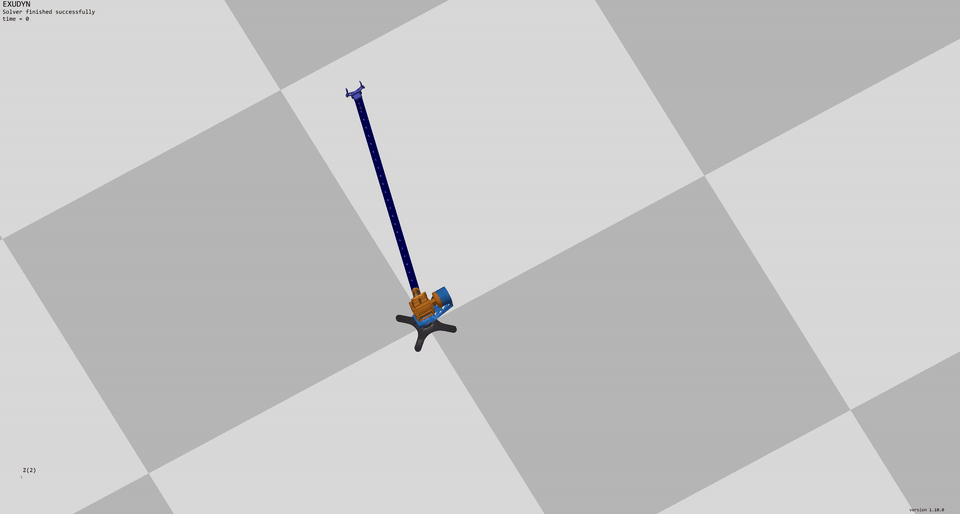
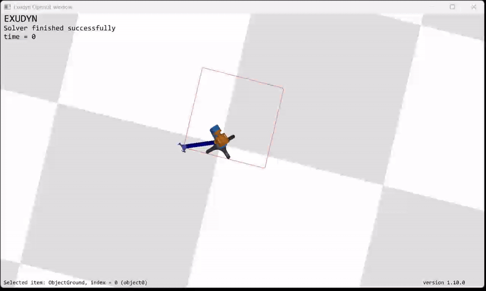

# User manual

This manual explains how to install the Python environment, run the steps that
reproduce the numerical results, generate Figs. 7 and 9, and use the `stemarm` library in your
own scripts. Section and equation numbers refer to the paper *Flexible dynamics
modeling for model-based vibration control of a variable-length space
manipulator*.

Contents

1. [Python environment](#1-python-environment)
2. [Repository layout](#2-repository-layout)
3. [Running the steps](#3-running-the-steps)
4. [The steps in detail](#4-the-steps-in-detail)
5. [The model](#5-the-model)
6. [Result files](#6-result-files)
7. [Using the library in your own scripts](#7-using-the-library-in-your-own-scripts), including [simulation animations](#78-simulation-animations)
8. [Function reference](#8-function-reference)
9. [Reproducibility notes](#9-reproducibility-notes)
10. [Troubleshooting](#10-troubleshooting)

---

## 1. Python environment

| Package | Reference version | Purpose |
| --- | --- | --- |
| Python | 3.13.5 | |
| [exudyn](https://github.com/jgerstmayr/EXUDYN) | 1.10.0 | flexible multibody simulation |
| numpy | 2.1.3 | arrays |
| scipy | 1.15.3 | inverse kinematics, splines, filters, eigenvalues, curve fits |
| matplotlib | 3.10.0 | Figs. 7 and 9 and interactive result previews |
| numpy-stl (optional) | 3.2.0 | link and gripper meshes in the Exudyn renderer |

The simulations of the paper were run on Windows 11 with these versions, and
`requirements.txt` and `environment.yml` pin them. The code also runs with
Python 3.10, NumPy 1.26 and Matplotlib 3.10.8; all results then agree with the
paper except one round-off-sensitive simulation (Section 9). Exudyn is
available for Windows, Linux and macOS, but only Windows was tested.

**With conda (recommended)**

```bash
conda env create -f environment.yml
conda activate stemarm
```

**With pip and a virtual environment**

```bash
python -m venv .venv
.venv\Scripts\activate          # Windows; on Linux/macOS: source .venv/bin/activate
pip install -r requirements.txt
```

**Check the installation**

```bash
python -c "import exudyn, numpy, scipy, matplotlib; print(exudyn.__version__)"
```

This should print `1.10.0`. Exudyn 1.10.0 must be used if the numbers are to
agree with the paper to the last digit (see Section 9).

**Fonts.** The figures use Arial, as required by the journal. Arial is
installed on Windows and macOS; on Linux, install it (for example the
`ttf-mscorefonts-installer` package) or matplotlib falls back to DejaVu Sans.
The fallback changes only the appearance, not the data.

---

## 2. Repository layout

```
thin-walled-extendable-manipulator_v6/
|-- README.md, USER_MANUAL.md, USER_MANUAL.pdf
|-- requirements.txt, environment.yml
|-- run_all.py                  runs all steps in order
|-- view_model.py               shows the model in the Exudyn renderer
|-- plot_s01_*.py               optional plotting scripts for the Fig. 7 benchmark
|-- s01_ancf_benchmark.py ... s11_modal_check.py   one script per subsection
|-- stemarm/                    library used by all steps (Section 8)
|   |-- params.py               parameters of Table 2
|   |-- section.py              properties of the thin-walled section (Section 2.4)
|   |-- arm.py                  URDF reader, kinematic tree of joints R1 and R2
|   |-- model.py                complete manipulator model (Section 2)
|   |-- commands.py             point-to-point joint and length commands
|   |-- shaping.py              ZVD / ZVD2 shapers, trapezoidal profiles, path-progress shaping
|   |-- path.py                 square path, inverse kinematics (Section 4.6)
|   |-- simulate.py             solver settings, run, save and load results
|   |-- modal.py                frozen-pose modal analysis, undamped and damped
|   |-- rig.py                  boom on the root spring, for the identification tests
|   |-- evaluation.py           residuals, J_RMS, spectra, frequency estimates
|   |-- mocap.py                readers for the motion-capture and controller files
|   |-- plotstyle.py            shared style for Figs. 7 and 9
|   |-- paths.py, runner.py     folders, command-line options, parallel runs
|-- model/stemarm/              URDF and display meshes of the manipulator
|-- data/                       measured data, described in data/README.md
|-- docs/media/                 simulation animations in the manual
|-- results/                    created by the scripts, not tracked by git
```

**Display meshes.** The STL files in `model/stemarm/meshes/` are simple
placeholder shapes (cylinders and boxes) with the approximate size of each
part; they do not reproduce the CAD geometry of the prototype. They are used
only for drawing in the renderer (`view_model.py`, `render=True`). The masses,
centres of mass, inertias and joint frames come from the URDF and from
`stemarm/params.py`, so the meshes have no influence on any result.

---

## 3. Running the steps

### All steps

```bash
python run_all.py
```

The steps run in the order of the paper, each in its own process. On a 6-core
PC the whole run takes about 1 h; more than half of it is step 8 (5 m boom with
a 0.25 ms time step). Options:

| Option | Effect |
| --- | --- |
| `--skip s08 s09` | leave out steps |
| `--only s06 s07` | run only these steps |
| `--workers N` | number of simulations run in parallel (default: min(6, number of cores)) |
| `--force` | rerun simulations that already have results |
| `--figures-only` | redraw Fig. 7 from existing benchmark results (runs s01 only) |
| `--render` | display the visualization for each selected step |

### A single step

```bash
python s05_ground_slews.py
python s06_model_validation.py
```

Every step prints its main numbers to the console and writes its files to
`results/<step name>/`; s01 and s02 write Figs. 7 and 9 to `results/figures/` as vector PDFs
and 600 dpi PNGs. The other steps report numerical results.

The simulation steps (s01, s04, s05, s08, s09, s10) accept `--workers` and
`--force`. By default a restarted run reuses completed simulations. Use
`--force` to recompute them. Three steps need results of s05:

* `s06_model_validation.py` and `s11_modal_check.py` need the unshaped slews of Cases A and B;
* `s10_slew_extension.py` needs the unshaped Case B slew.

Step-specific options:

* `s03_root_damping.py --fit` searches the damping D instead of checking the paper value;
* `s05_ground_slews.py --joint-drive constraint` imposes the joint motion through constraints (Section 9).

### Visualization with `--render`

Each step accepts `--render`. Run the command in a desktop session with
graphics support. Install `numpy-stl` for the manipulator meshes in s04, s05,
s08, s09, and s10.

```bash
python -m pip install numpy-stl==3.2.0
python s05_ground_slews.py --render
python run_all.py --only s06 s07 --render
```

| Step | Display |
| -------------- | ------------------------------------ |
| s01 | Live 3D ANCF deployment, then the ANCF and ALE-ANCF comparison in Fig. 7. |
| s02 | Static deflection at the longest tested boom length with the heaviest tip mass. |
| s03 | Free decay of the loaded boom after release. |
| s04, s05, s08, s09, s10 | Live manipulator simulations for each motion case. |
| s06, s07, s11 | Interactive plots of model validation, measured residuals, and fitted residual frequencies, respectively. |

With `--render`, motion cases displayed in Exudyn are recomputed even if
stored results exist. They run one at a time and each window closes after
the solve. Close a Matplotlib preview to finish its step. The s05 result
dependencies listed above also apply when opening previews. To view Fig. 7
from stored results, run s01 with both `--figures-only` and `--render`.

### Figures 7 and 9

Run `python run_all.py --only s01 s02` to generate both figures. If the benchmark
CSV files already exist, `python s01_ancf_benchmark.py --figures-only` redraws Fig. 7
from those files. Fig. 9 is regenerated by running `python s02_root_stiffness.py`.

The optional scripts `plot_s01_benchmark_abc.py` and `plot_s01_local_frequency.py`
use the same benchmark CSV files. Install their extra dependency before running them.

```bash
python -m pip install plotnine
```

### Results folder

Results are written to `./results`. To keep them elsewhere, set the
environment variable `STEMARM_RESULTS_DIR` before running:

```bash
set STEMARM_RESULTS_DIR=D:\stemarm_results        # Windows cmd
$env:STEMARM_RESULTS_DIR = "D:\stemarm_results"   # PowerShell
export STEMARM_RESULTS_DIR=$HOME/stemarm_results  # Linux/macOS
```

### Run times

Measured on a 6-core Windows PC with the default number of workers.

| Step | Simulations | Wall time |
| --- | --- | --- |
| s01 | 4 (two models, two speeds) | 2 min |
| s02 | 24 static | 1 min |
| s03 | 1 (several with `--fit`) | 1 min |
| s04 | 2 + 11 modal analyses | 3 min |
| s05 | 6 | 1-2 min |
| s06, s07 | none | < 1 min |
| s08 | 6 | 35 min |
| s09 | 11 + 8 modal snapshots | 8 min |
| s10 | 8 | 1 min |
| s11 | modal analyses only | 1 min |

---

## 4. The steps in detail

The numbers below are those printed by the scripts with the tested versions.

### s01 Deployment benchmark (Section 4.2, Fig. 7)

The benchmark of Park et al. (2013): a beam of initial length 1.8 m with an
initial tip deflection of 5 mm is extended at 0.1 m/s without gravity. The
present model (3D ANCF elements whose reference length follows the deployed
length) is compared with a planar ALE-ANCF model that keeps the transport terms
and with the digitized published response (`data/park2013`). The run is
repeated at 0.3 m/s.

* RMS deviation from Park et al. at 0.1 m/s: present model 0.67 mm, ALE-ANCF 0.26 mm.
* RMS difference ALE-ANCF minus present model: 0.60 mm (0.1 m/s), 0.93 mm (0.3 m/s; printed only,
  no longer quoted in Section 4.6 since 2026-11-16).
* Output: `fig3_ANCF_ALE_validation`, `results/s01_ancf_benchmark/` (tip responses as CSV, `metrics.txt`).

### s02 Root stiffness K (Section 4.3, Fig. 9)

24 static tests (3 tip masses, 8 deployed lengths). The beam and axial
compliances are subtracted from the measured deflection and K follows from the
least-squares fit through the origin. Each test is then simulated statically
with the ANCF boom on the root spring.

* K = 64.83 N m/rad; static validation R^2 = 0.9948, RMSE 1.80 mm.
* Output: `static_root_stiffness_validation`, `identified_stiffness.txt`, `static_validation.csv`.

### s03 Root damping D (Section 4.3)

Three free-decay tests at a deployed length of 1 m with a 420 g tip mass. The
damping ratio is taken from an exponential fit to the displacement peaks
between 5 and 20 mm. The release is simulated with K fixed, and D is chosen so
that the simulated damping ratio, evaluated in the same way, equals the
measured one.

* Measured zeta = 0.01303 (mean of three tests); D = 0.15411 N m s/rad gives the same simulated zeta.
* Damped frequency: 1.859 Hz simulated, 1.837 Hz measured.
* Output: `root_damping.txt`.

### s04 Deployment test (Section 5.1)

Analysis of the extension to 1 m at a commanded 30 mm/s with the arm at
q = (0, 90) deg, run twice (`run_1`, `run_2`). The measured dominant Z frequency
in 3 s windows is compared with the first natural frequency of the model.
The simulation uses the commanded trapezoid and the recorded stroke of run 2.

* Travel 980 mm (run 2), speed 29.6 / 29.9 mm/s (run 2) and 29.7 / 29.9 mm/s (run 1),
  return error 0.93 mm (run 2) and 5.49 mm (run 1); the hold lasts 3.2 s in run 2 and
  1.7 s in run 1.
* Frequency versus length: the deployed length of each window is taken from the
  measured stroke (0.03 to 1.00 m). The model frequency is the damped first mode of
  the model with gravity and the joints locked (`stemarm.modal.damped_modes`),
  3.13 Hz at 1.0 m, equal to the decaying-sinusoid fit of the simulated residual.
  Over 0.45-0.98 m (144 windows, both runs) the measured / model ratio has a median
  of 1.00 and a 10-90 % range of 0.89-1.08; medians 0.97 / 0.93 (extension, runs 1 / 2)
  and 1.03 / 1.04 (retraction). No consistent peak below 0.45 m.
* Stop: sinusoid fits of Z give 3.21 / 3.26 Hz over the last 2.5 s of the extension
  (mean length 0.97 m, model 3.24 Hz) and 3.50 Hz in both runs over the 1.5 s after
  the stop (model 3.13 Hz, 11 % lower); fitted amplitude 1.27 / 0.59 mm before and
  1.13 / 0.44 mm after the stop.
* Amplitude during the strokes (Z above 1.5 Hz, window medians): 0.25-0.31 mm at
  0.45-0.55 m and 0.45-0.86 mm above 0.9 m; simulation at most 0.0009 mm (commanded)
  and 0.0165 mm (recorded stroke) in the same windows.
* Hold window (run 2): Z RMS 0.30 mm, spectral peak 3.48 Hz; simulation 0.0225 mm,
  recorded stroke -5.4 %.
* Output: simulations in `results/s04_deployment_test/`,
  `model_first_mode.csv` (model frequency versus length; delete it or run with
  `--force` to recompute) and `frequency_track.csv` (per window: run, phase,
  length, measured and model frequency, Z RMS).

### s05 Ground slews, simulation (Sections 5.2 and 5.3)

Case A (q2 from 10 to 90 deg) and Case B (q1 from 0 to 90 deg and q2 from 10 to
90 deg) at a deployed length of 1.0 m with gravity, each continued 20 s after
the command. The unshaped slews are used by s06, s10 and s11. The script also
runs both cases with a ZVD shaper at 3.5 Hz and a ZVD2 shaper at 3.5 + 4.0 Hz;
these runs are not used in the paper.

### s06 Simulation versus experiment (Section 5.2, Table 4)

Compares the unshaped simulations of s05 with the first unshaped trial of
each case in `data/shaping_tests` (the trials of Section 5.3).
For these slews the marker point P of the simulation is shifted along the boom
axis by `MARKER_AXIAL_SHIFT_SLEW_MM` = -25.79 mm, set from the final X position
after Case A; the simulated final tip height after Case B then differs from the
measured one by 3.97 mm. The shift only moves the output point, so the s05
simulations are reused unchanged. The measured end positions are also offset by
about 16 mm normal to the boom (Y in Case A, X in Case B), which the axial shift
does not remove; the Y RMSE of Case A (15 mm, small travel) is therefore not quoted.

* Joint angles: RMSE at most 1.10 deg; tip coordinates with large travel: RMSE 27-37 mm, below 4.2 % of their range.
* Table 4 (simulation / experiment): Case A RMS 2.39 / 2.09 mm, peak 13.68 / 10.43 mm;
  Case B RMS 1.88 / 1.37 mm, peak 10.50 / 5.66 mm; dominant frequency over 20 s 3.10 / 3.55 Hz (A), 3.10 / 3.60 Hz (B).
* RMS over tau in [15, 20] s (quoted in the text, not written by the script): simulation 0.015 / 0.022 mm,
  experiment 0.49 / 0.63 mm (A / B).
* Amplitude dependence: decaying sinusoids fitted to tau windows [0, 2], [2, 5], [5, 10] and [10, 20] s
  of the Z residual of the simulation and of all three unshaped trials. Measured frequency rises from
  3.44-3.47 Hz (A) and 3.55 Hz (B) over [0, 2] s (amplitude 5-10 mm) to 3.57-3.58 / 3.62-3.63 Hz over
  [10, 20] s (about 1.5 mm); measured damping ratio falls from 0.012-0.019 to 0.003-0.006. The simulation
  stays at 3.08 Hz and 0.022 in every window. The offset is 10-13 % right after the motion and 14-15 %
  at low amplitude.
* Command excitation: the commanded joint-2 angle drives a single mode with zeta = 0.013; the free
  vibration after the command is 2.5 / 7.5 times larger at 3.10 Hz than at 3.45 / 3.55 Hz (A) and
  4.3 / 6.6 times larger than at 3.55 / 3.60 Hz (B); the excitation has a minimum at 3.59 Hz (A) and
  3.66 Hz (B). The amplitude is scaled by 1.2 m (approximate radius of P), which does not change the ratios.
* Output: `table3_residual_z.csv`,
  `motion_metrics.csv` (RMSE and R^2 of joint angles and tip coordinates),
  `residual_window_fits.csv` (per window: amplitude, frequency, damping ratio) and
  `command_excitation.csv` (free amplitude versus mode frequency, 2.8-4.0 Hz).

### s07 Measured vibration suppression (Section 5.3)

Uses only the measurements in `data/shaping_tests`: the unshaped command and
the ZVD shaper designed for 3.1 Hz, the frequency predicted by the model
(damping ratio 0.01); three trials per case and command. tau = 0 is the end of
the command, when the last joint stops (`stemarm.mocap.command_window`, via
`stemarm.mocap.load_slew`). Each case uses its own baseline, the median over
the last 2 s of its shortest record; J_RMS over [0, 2.5] s, eta_RMS against the
mean unshaped J_RMS of the same case.

* Case A, Z: 4.07 +- 0.40 mm unshaped, 2.24 +- 0.59 mm shaped, reduction 44.8 % (single trials 29.0-57.4 %).
* Case A, Y (horizontal, normal to the boom): 1.57 +- 0.41 / 0.78 +- 0.26 mm, reduction 50.4 %.
* Case B, Z: 2.65 +- 0.20 / 1.03 +- 0.17 mm, reduction 61.3 %; Case B, X: 3.30 +- 0.50 / 0.74 +- 0.22 mm,
  reduction 77.5 % (single trials 55.8-81.7 % for Z and X).
* Every shaped trial has a lower J_RMS than every unshaped trial of the same case and coordinate.
* Unshaped frequency over [0, 20] s: Z 3.55 Hz (A), 3.60 Hz (B); horizontal 3.30 Hz (both).
* During the slew (2.6-4.2 Hz band, tau in [-duration, 0]): reduction 38.7 % (A, Z), 56.1 % (B, Z),
  2.9 % (A, Y), 11.7 % (B, X).
* What remains after shaping: in every shaped trial and coordinate, at least 93 % of the mean square of
  the residual over tau in [0, 2.5] s lies in the 2.6-4.2 Hz band; the band RMS over the last 2 s of all
  records is 0.01-0.15 mm.
* Joint excitation: the commanded and the encoder angle of each joint (controller log, encoder low-pass
  15 Hz) drive a single mode at the measured frequency with zeta = 0.013 up to the end of the command;
  the response RMS over tau in [0, 2.5] s is the excitation of the mode by that joint. Joint 1 (Case B,
  3.30 Hz): measured/commanded 1.19 unshaped; the shaper reduces the commanded excitation by 99.3 % and
  the measured one by 94.6 %. Joint 2: measured/commanded 2.21 (A, 3.55 Hz) and 2.07 (B, 3.60 Hz); the
  shaper reduces the commanded excitation by 89.6 % / 88.8 % and the measured one by 29.6 % / 33.3 %.
* Output: `experiment_shaping_trials.csv` (per trial:
  command duration, J_RMS, eta_RMS, frequency over 20 s, largest residual over [0, 0.5] s, band RMS during the slew)
  and `experiment_joint_excitation.csv` (per trial and joint: mode frequency, commanded and measured excitation).

### s08 5 m boom under microgravity (Section 4.4)

The slews of Cases A and B with a 5 m boom and gravity off. The shapers are
designed from the unshaped model response: ZVD at 0.45 Hz and ZVD2 at
0.45 + 0.50 Hz. Time step 0.25 ms.

* J_RMS of the Z residual, Case A: 1940.95 mm unshaped, 0.59 mm ZVD, 0.32 mm ZVD2
  (reductions 99.97 % and 99.98 %); Case B: 1255.8 mm unshaped, 86.6 mm ZVD,
  43.1 mm ZVD2 (reductions 93.1 % and 96.6 %).
* Shaper durations 2.22 s (ZVD) and 4.22 s (ZVD2), unshaped commands 1.90 s (A) and 2.07 s (B);
  maximum root rotation 26.7 / 24.2 deg unshaped, below 4.3 deg shaped.
* Unshaped Z, decaying-sinusoid fits over tau [0, 5], [5, 10], [10, 20] s: Case A 0.454-0.455 Hz,
  damping ratio 0.002; Case B 0.4554 -> 0.4505 Hz, damping ratio 0.015-0.017. The 0.50 Hz bin of
  the 0.05 Hz spectrum is leakage of this single oscillation.
* Single damped mode (zeta 0.01): ZVD leaves 2.9 % of the residual amplitude at 0.40 and 0.50 Hz,
  ZVD2 at most 0.27 % from 0.40 to 0.55 Hz. Case A ZVD (0.03 %) matches this; Case B ZVD (6.9 %)
  is far larger than the frequency difference alone would leave.
* Output: simulations and `residual_metrics.csv` in `results/s08_microgravity_5m/`.

The unshaped Case B response is very sensitive to round-off; see Section 9.

### s09 Square path (Section 4.6, Table 3)

The tip follows a 1 m square in the plane z = 2 m under microgravity while the
boom extends and retracts. Six commands (unshaped, ZVD at three frequencies,
ZVD2 with and without the zero-time-delay scheme) and eight frozen-pose modal
analyses along the path.

With `--render`, the red trail shows the sampled positions of the final ANCF node.

* Frozen-pose frequencies (quoted in the text): 1.28-1.76 Hz, median 1.50 Hz.
* Table 3: J_RMS reduction 92.5 % for ZVD at 1.685 Hz, 91.6 % at 1.492 Hz.
* Corner rest 1.7 s (text of Section 4.6): the tip stops at every corner; J_RMS
  reduction 97.0 % for ZVD2, 92.9 %, 86.5 % and 59.6 % for ZVD at 1.492, 1.250 and 1.685 Hz.
* During the unshaped motion, the out-of-plane deviation has a spectral peak at 1.25 Hz.
* Output: `table4_frozen_modes.csv`, `table5_square_path.csv`, and `long_rest_square_path.csv`.

### s10 Slew with extension (Section 4.5)

The Case B slew combined with an extension from 1.0 to 1.2 m, unshaped and
with ZVD at 3.10 Hz (frequency at the initial length, from s05) and 2.55 Hz
(at the final length) and ZVD2 at both.

* J_RMS reduction: ZVD 3.10 Hz 79.1 %, ZVD 2.55 Hz 86.5 %, ZVD2 87.9 %.
* Same commands without gravity: 93.7 %, 99.7 %, 99.97 %.
* Output: simulations and `metrics.json` in `results/s10_slew_extension/`.

### s11 Modal check of the ground slews (supports Section 5.2)

Complex modes of the model at a deployed length of 1 m and the final poses of
Cases A and B, compared with a decaying sinusoid fitted to the simulated
residual of s05 and to the first measured trial in consecutive time windows.
Needs the results of s05.

* Complex modes: first mode fd 3.13 Hz with and without gravity, zeta 0.022.
* Simulated residual: 3.08 Hz, zeta 0.022.
* Measured residual: 3.32 to 3.49 Hz (Case A) and 3.41 to 3.54 Hz (Case B) as the amplitude decays.
* Output: `complex_modes.csv`, `residual_fit.csv`.

---

## 5. The model

### Parameters

All parameters are in `stemarm/params.py`; every script reads them from there.

| Paper | Code | Value |
| --- | --- | --- |
| R_o, R_i | `R_OUTER`, `R_INNER` | 25.5 mm, 25.0 mm |
| E, nu, rho (equivalent) | `E_EQ`, `NU_EQ`, `RHO_EQ` | 130 GPa, 0.3, 1800 kg/m^3 |
| k_eta, k_zeta (shear correction) | `K_ETA`, `K_ZETA` | 0.39, 0.50 |
| N (elements) | `N_ELEMENTS` | 48 |
| K_theta_zeta | `K_ROOT` | 64.833 N m/rad |
| D_theta_zeta | `D_ROOT` | 0.15411 N m s/rad |
| beta (mounting bias) | `BIAS_DEG` | 5.785 deg |
| d_a (axial root offset) | `ROOT_AXIAL_OFFSET` | 1.10 mm |
| Marker shift for the slews of `data/shaping_tests` (s06 only) | `MARKER_AXIAL_SHIFT_SLEW_MM` | -25.79 mm |
| Constant transforms (Table 1) | `JOINT3_XYZ`, `JOINT3_RPY`, `GRIPPER_*` | |
| Joint limits of the slews | `JOINT_VMAX`, `JOINT_AMAX` | 1 rad/s, 2 rad/s^2 |
| Start and end angles of Cases A and B | `CASES` | |
| h, rho_inf | `STEP_SIZE`, `SPECTRAL_RADIUS` | 1 ms, 0.5 |
| Sampling of the stored responses | `SENSOR_PERIOD` | 2 ms |

The section properties (area, centroid offset d_c, second moments, torsion
constant, shear stiffnesses) are computed from these values in
`stemarm/section.py`; `python -c "from stemarm.section import section_properties as s; print(s())"`
prints them.

### Structure

`stemarm.model.Manipulator` builds the model into an Exudyn `MainSystem`:

* **Joints R1, R2**: an Exudyn `KinematicTree` read from
  `model/stemarm/urdf/stemarm.urdf` (masses, inertias and joint frames).
* **Boom**: N `ObjectANCFBeam` elements on the centroidal axis, starting at the
  root point offset by d_a along the boom axis and d_c across it. Gravity acts
  on the boom as nodal loads.
* **Root connection** (Section 2.5): a `GenericJoint` that leaves only the
  rotation about zeta free, and a `TorsionalSpringDamper` (K, D) about that axis.
* **End-effector**: a rigid body fixed to the tip node (`GRIPPER_*` in `params.py`).
* **Marker P**: the motion-capture point, a constant offset in the tip frame.

### Variable length (Section 2.3)

The deployed length is changed by setting the reference length of every
element to l(t)/N before each time step (`Manipulator.set_length`); the nodal
gravity loads follow. Transport terms of the axially moving material are not
modelled; s01 quantifies the resulting error.

### Joint motion

The joint angles are prescribed. Two ways are implemented:

* `joint_drive="constraint"` (default): coordinate constraints with
  q_j(t) = command(t), enforced in every Newton iteration.
* `joint_drive="state"`: the joint coordinates, velocities and accelerations
  are overwritten before every time step.

Step s05 uses `state`, which was used for the ground slews in the paper; all
other steps use `constraint`. See Section 9 for the difference.

### Time integration

Generalized-alpha (`simulate.simulation_settings`): h = 1 ms, rho_inf = 0.5,
adaptive step, modified Newton; responses are stored every 2 ms. Exceptions:
s01 uses h = 0.1 ms and rho_inf = 0.95, s04 rho_inf = 0.9, s08 h = 0.25 ms
with full Newton.

### Input shaping

`stemarm.shaping.make_shaper("zvd" | "zvd2", frequencies, zeta)` returns the
impulse amplitudes and times. `stemarm.commands.PointToPoint` convolves the
synchronized trapezoidal joint profiles with the shaper. For the square path,
`stemarm.path.SquareCommand` applies path-progress shaping with the
zero-time-delay scheme of Section 3.2.

---

## 6. Result files

Each simulation folder holds three files.

**`result.npz`** (NumPy archive, SI units, radians)

| Key | Shape | Content |
| --- | --- | --- |
| `t` | (n,) | time [s], sampled every 2 ms |
| `q`, `qd` | (n, 2) | joint angles and rates of R1, R2 |
| `tip` | (n, 3) | position of the boom tip node [m] |
| `tip_rot` | (n, 3, 3) | rotation matrix of the tip node |
| `root`, `root_rot` | (n, 3), (n, 3, 3) | position and rotation of the boom root node |
| `theta_root` | (n,) | rotation of the root spring [rad] |
| `marker` | (n, 3) | position of marker point P [m] |

**`meta.json`**: the settings of the run (case, shaper, frequencies, length,
gravity, joint drive, command end time).

**`response.csv`**: the same data in readable form, columns
`t_s, q1_deg, q2_deg, tip_x_mm, tip_y_mm, tip_z_mm, marker_x_mm, marker_y_mm, marker_z_mm, root_rotation_deg`.

Load a result in Python with

```python
from stemarm import simulate
r = simulate.load("results/s05_ground_slews/case_B_none")
print(r["meta"], r["tip"].shape)
```

The measured data and their formats are described in `data/README.md`.

---

## 7. Using the library in your own scripts

Run your script from the repository root (or add the root to `PYTHONPATH`) so
that `stemarm` can be imported. Angles passed to the commands are in degrees;
everything else (joint angles in results, modal analysis, lengths, positions)
is in radians and metres. All examples below were run with the reference
versions; the printed values are given in the comments.

### 7.1 A slew with a ZVD shaper, saved and reloaded

```python
import numpy as np
from stemarm import paths, shaping, simulate
from stemarm.commands import PointToPoint

shaper = shaping.make_shaper("zvd", [3.1], 0.01)                     # design frequency [Hz], damping ratio
command = PointToPoint((0, 10), (0, 90), shaper=shaper, length=1.0)    # q1, q2 [deg]: Case A
result = simulate.run(command, command.q_start, 1.0, command.end_time + 3.0, gravity=True, verbose=0)
print("tip z at the end: %.1f mm" % (1e3 * result["tip"][-1, 2]))      # 246.1 mm

folder = paths.result_dir("examples", "case_A_zvd")
simulate.save(result, folder, {"note": "ZVD 3.1 Hz"})
r = simulate.load(folder)                                              # same arrays + r["meta"]
```

### 7.2 Design frequency from the model (Section 3.2)

The model is driven by the unshaped command, and the design frequency is the
largest peak of the residual spectrum over 20 s after the command.

```python
from stemarm import params as P, evaluation, shaping, simulate
from stemarm.commands import PointToPoint

spec = P.CASES["A"]
command = PointToPoint(spec["q_start_deg"], spec["q_end_deg"], length=1.0)
result = simulate.run(command, command.q_start, 1.0, command.end_time + 20.0, gravity=True,
                      joint_drive="state", verbose=0)                  # as in s05
tau = result["t"] - command.end_time                                   # time after the command [s]
z = 1e3 * result["marker"][:, 2]                                       # Z of marker point P [mm]
z_eq = evaluation.median_baseline(tau, z, 18.0, 20.0)
f, a = evaluation.residual_spectrum(tau, z - z_eq, 20.0)               # 0.05 Hz resolution
f_design = evaluation.top_peaks(f, a, count=1, f_min=1.0)[0][0]        # 3.10 Hz
j_rms = evaluation.window_rms(tau, z - z_eq, 0.0, 2.5)["rms"]          # J_RMS over [0, 2.5] s
shaper = shaping.make_shaper("zvd", [f_design], 0.01)
```

With the default `joint_drive="constraint"` the same lines give 3.15 Hz, one
spectral bin higher (Section 9).

### 7.3 A slew combined with a boom extension

`length_end`, `length_vmax` and `length_amax` add a trapezoidal extension that
is synchronized with the joints and shaped with them; `variable_length=True`
makes the model follow it.

```python
command = PointToPoint((0, 10), (90, 90), shaper=shaper, length=1.0, length_end=1.2,
                       length_vmax=0.1, length_amax=0.2)               # [m], [m/s], [m/s^2]
result = simulate.run(command, command.q_start, 1.0, command.end_time + 2.0, gravity=True,
                      variable_length=True, verbose=0)
print(command.length_pva(result["t"][-1])[0])                          # 1.2
```

### 7.4 Natural frequencies of a frozen pose

```python
import numpy as np
from stemarm.modal import damped_modes, frozen_modes, dominant_planar_mode

for f_n, f_d, zeta in damped_modes(np.deg2rad([0.0, 90.0]), 1.0, gravity=True, n_modes=2):
    print(f_n, f_d, zeta)          # 3.130 3.129 0.0219 (vertical), 7.806 7.806 0.0000 (horizontal)

rows = frozen_modes(np.deg2rad([0.0, 90.0]), 1.0)   # undamped, no gravity; columns f, tip_xi, tip_eta, tip_zeta
f_planar = dominant_planar_mode(rows, f_band=(1.0, 5.0))
```

Deployed-length sweeps (as in s04) simply call `damped_modes` for each length.

### 7.5 A measured slew

```python
import os
from stemarm import evaluation, paths
from stemarm.mocap import load_slew

base = os.path.join(paths.DATA_DIR, "shaping_tests", "case_A", "none")
trial = load_slew(os.path.join(base, "1"), [os.path.join(base, k) for k in "23"])
z_eq = evaluation.median_baseline(trial["tau"], trial["z"], 15.0, 20.0)
print(evaluation.window_rms(trial["tau"], trial["z"] - z_eq, 0.0, 2.5)["rms"])   # 4.49 mm
```

`trial["x"]`, `["y"]`, `["z"]` are in mm in the simulation frame, `trial["tau"]`
in s after the end of the command.

### 7.6 Your own command

Any object with the attributes and methods below can drive the model; see
`stemarm/commands.py` and `stemarm/path.py` for the two commands of the paper.

| Member | Meaning |
| --- | --- |
| `q_start` | initial joint angles (2,) [rad] |
| `end_time` | time at which the command comes to rest [s] |
| `joint_pva(t)` | `(q, qd, qdd)`, three arrays of shape (2,) [rad, rad/s, rad/s^2] |
| `length_pva(t)` | `(l, ld, ldd)`, deployed length [m] and its derivatives |

```python
class CosineSlew:
    """q2 from 10 to 90 deg with a cosine profile over 2 s, starting at t = 0.5 s."""

    def __init__(self):
        self.q_start = np.deg2rad([0.0, 10.0])
        self.end_time = 2.5

    def joint_pva(self, t):
        s, d = np.clip((t - 0.5) / 2.0, 0.0, 1.0), np.deg2rad(80.0)
        moving = 0.0 < s < 1.0
        q = self.q_start + [0.0, 0.5 * d * (1.0 - np.cos(np.pi * s))]
        qd = [0.0, 0.5 * d * np.pi / 2.0 * np.sin(np.pi * s)] if moving else [0.0, 0.0]
        qdd = [0.0, 0.5 * d * (np.pi / 2.0) ** 2 * np.cos(np.pi * s)] if moving else [0.0, 0.0]
        return q, np.array(qd), np.array(qdd)

    def length_pva(self, t):
        return 1.0, 0.0, 0.0

command = CosineSlew()
result = simulate.run(command, command.q_start, 1.0, command.end_time + 1.0, verbose=0)
```

### 7.7 Kinematics without a simulation

```python
from stemarm.model import kinematics, rigid_tip
from stemarm.section import section_properties

props = section_properties()                     # props["EI_z"] = 311.44 N m^2, props["d_c"] = 9.175 mm
robot, root_local, r_mount, arm = kinematics()
tip = rigid_tip(robot, root_local, r_mount, np.deg2rad([0, 90]), 1.0)   # [-1.1801, 0.0020, 0.2725] m
```

To watch a single slew, run `python view_model.py` (needs numpy-stl) or pass
`render=True` to `simulate.run`. Press Space in the Exudyn window before
and after the motion. For automatic start and close, also pass
`render_pause=False`.

### 7.8 Simulation animations

**Large-deformation motion of the flexible manipulator**



**Boom-tip motion along a square path**



---

## 8. Function reference

Public functions and classes of the `stemarm` package. Units are SI and
radians unless stated otherwise; functions that read measured data work in mm.
Private helpers (names starting with `_`) are not listed.

### 8.1 `stemarm.params`

Constants only; see the table in Section 5. Further groups:
`CROSS_SECTION_PENALTY` (Exudyn cross-section penalty of `ObjectANCFBeam`),
`MARKER_POINT_MM`, `ROD_POINT_MM`, `MARKER_CALIBRATION_Q_DEG` (calibration of
marker point P), `MOCAP_ORIGIN_OFFSET_MM` (motion-capture origin in the
simulation frame), `HOST_TRAJ_DT` (sample time of the host trajectory, 5 ms),
`GRAVITY`.

### 8.2 `stemarm.section`

**`section_properties(r_outer=R_OUTER, r_inner=R_INNER, e_mod=E_EQ, nu=NU_EQ, rho=RHO_EQ, k_eta=K_ETA, k_zeta=K_ZETA)`**
Properties of the semi-annular section about its centroid. Returns a dict with
`A`, `eta_c`, `r_mid`, `d_c`, `I_y`, `I_z`, `J_t`, `J_mass`, `E`, `G`, `rho`,
`EA`, `GA_eta`, `GA_zeta`, `GJ`, `EI_y`, `EI_z`, `rhoA`.

**`beam_section(props)`**
Exudyn `BeamSection` with the diagonal stiffness of Eq. (26), the rotary
inertia and the mass per length. The boom has no structural damping.

**`section_geometry(props, r_outer=R_OUTER, r_inner=R_INNER, n_arc=180)`**
Polygon of the section relative to the centroid, for drawing only.

### 8.3 `stemarm.arm`

**`rpy_to_rot(rpy)`**
Rotation matrix of URDF roll-pitch-yaw angles, R = Rz(y) Ry(p) Rx(r).

**`read_urdf(path=URDF_FILE)`**
Reads the URDF. Returns `{"base": link, "chain": [link, ...]}`; each link is a
dict with `name`, `mass`, `com`, `inertia`, `mesh`, `color` and, for the
movable links, `joint`, `parent`, `preHT` and `limits`.

**`build_robot(arm, gravity, with_graphics=False)`**
Exudyn `Robot` (kinematic tree) of the joint chain from `read_urdf()`; the
joints are driven externally.

### 8.4 `stemarm.model`

**`Manipulator(mbs, command, q0, length0, gravity=True, joint_drive="constraint", variable_length=False, n_elements=N_ELEMENTS, with_graphics=False)`**
Builds the complete model into the Exudyn system `mbs`.

| Argument | Meaning |
| --- | --- |
| `command` | object with `joint_pva(t)` and `length_pva(t)` (Section 7.6) |
| `q0`, `length0` | initial joint angles [rad] and deployed length [m] |
| `gravity` | gravity on links, boom and end-effector |
| `joint_drive` | `"constraint"` or `"state"` (Section 5) |
| `variable_length` | update the element length from `command.length_pva(t)` |
| `n_elements` | number of ANCF elements |
| `with_graphics` | add the display meshes (needs numpy-stl) |

Useful attributes: `robot` (Exudyn `Robot`), `props` (section properties),
`sensors` (dict of sensor numbers: `q`, `qd`, `tip_pos`, `tip_rot`, `root_pos`,
`root_rot`, `theta_root`), `axes` (undeformed boom axes xi, eta, zeta),
`root_local`, `marker_offset`, `first_node`, `last_node`, `elements`.
Methods: `set_length(t)` sets the element length to l(t)/N (called before
each step when `variable_length=True`); `rigid_tip(q, length)` is the tip of
the undeformed boom, Eq. (46).

`simulate.run` creates the system, the `Manipulator` and the solver in one
call; use `Manipulator` directly only to add items of your own.

**`kinematics()`**
Returns `(robot, root_local, r_mount, arm)` for kinematic calculations without
a model.

**`rigid_tip(robot, root_local, r_mount, q, length)`**
Tip position of the undeformed boom on its centroidal axis, Eq. (46) [m].

**`mount_rotation(bias_deg=BIAS_DEG)`**, **`beam_frame(r_parent, r_mount)`**,
**`root_point_in_link2(props, r_mount)`**, **`marker_offset(robot, props, r_mount, q_cal=MARKER_CALIBRATION_Q_DEG)`**,
**`gripper_inertia()`**, **`rot_axis_angle(axis, theta)`**, **`normalize(v)`**
Building blocks of the model: rotation of the root frame (beta about zeta),
unit vectors of the boom, root point in link 2 (d_a and d_c), offset of marker
P in the tip frame, end-effector inertia about the tip node, Rodrigues
rotation, unit vector.

### 8.5 `stemarm.commands`

**`PointToPoint(q_start_deg, q_end_deg, shaper=None, length=1.0, length_end=None, length_vmax=None, length_amax=None, vmax=JOINT_VMAX, amax=JOINT_AMAX)`**
Synchronized point-to-point slew (Section 3.2). Every moving joint follows a
trapezoidal profile with limits `vmax` [rad/s] and `amax` [rad/s^2]; all
profiles, and the optional extension from `length` to `length_end`, are
stretched to the slowest one and convolved with `shaper` (Eq. 38).
Attributes: `q_start` [rad], `duration` (unshaped command) and `end_time`
(shaped command) [s]. Methods `joint_pva(t)`, `length_pva(t)` as in Section 7.6.

### 8.6 `stemarm.shaping`

A shaper is a tuple `(A, T)` of impulse amplitudes and times.

| Function | Returns |
| --- | --- |
| `zvd(fn, zeta)` | ZVD shaper for natural frequency `fn` [Hz] and damping ratio `zeta` |
| `zvd2(fn_1, fn_2, zeta_1=0.01, zeta_2=0.01)` | ZVD(fn_1) convolved with ZVD(fn_2), Eq. (37) |
| `make_shaper(kind, frequencies=(), zeta=0.01)` | `"none"`, `"zvd"` (first frequency) or `"zvd2"` (first two) |
| `convolve(shaper_1, shaper_2)` | convolution, impulses sorted by time |
| `merge_equal_times(shaper, tol=1e-12)` | impulses at equal times merged, amplitudes normalized to 1 |
| `duration(shaper)` | shaper duration t_N [s] |
| `Trapezoid(distance, vmax, amax)` | rest-to-rest profile; `total_time`, `pva(t)`, `pva_stretched(t, duration_common)` |
| `length_trapezoid_pva(t, l_start, l_end, vmax, amax)` | deployed length, rate and acceleration of a one-way extension |
| `length_trapezoid_time(l_start, l_end, vmax, amax)` | duration of that extension [s] |
| `uniform_time_grid(end, dt)` | samples 0, dt, ..., ending exactly at `end` |
| `shape_path_progress(times, progress, shaper, dt, t_acc=0.0)` | shaped time grid, shaped progress S(t) and compression k, Eqs. (39)-(45) |

### 8.7 `stemarm.path`

Square path of Section 4.6. Constants: `CENTER`, `SIDE`, `CORNER_HOLD`, `DT`,
`Q_START_DEG`, `L_START`, `EDGE_VMAX`, `EDGE_AMAX`.

**`SquareCommand(shaper=None, zero_delay=True, corner_hold=CORNER_HOLD)`**
Joint and length command along the square: time law, optional path-progress
shaping, bounded inverse kinematics and a cubic Hermite spline. With
`zero_delay=True` the time law is compressed so that the shaped motion ends with
the unshaped one. Attributes: `q_start`, `end_time`, `k`, `t_acc`,
`shaper_duration`, `times`, `q_table`. Methods: `joint_pva(t)`,
`length_pva(t)`, `desired_tip(t)` (tip of the commanded rigid path),
`check(dt=0.002)` (peak joint rates and contour error), `corner_speed(dt, radius)`
(v_c of Table 3).

**`SquarePath()`** (`point(s)`, `distance(xyz)`), **`square_corners()`**,
**`edge_timing(distance, vmax, amax)`**, **`edge_distance(t, distance, vmax, amax)`**,
**`time_law(path, dt=DT, hold=CORNER_HOLD)`**
The geometric path gamma(s) and its unshaped time law.

### 8.8 `stemarm.simulate`

**`run(command, q0, length0, end_time, gravity=True, joint_drive="constraint", variable_length=False, step_size=STEP_SIZE, modified_newton=True, render=False, verbose=1, spectral_radius=SPECTRAL_RADIUS, *, render_pause=True, render_tip_trace=False)`**
Builds the model, integrates until `end_time` and returns a dict of arrays
sampled every `SENSOR_PERIOD` (keys as in Section 6) plus the `Manipulator`
under `"model"`. `render=True` opens the Exudyn renderer, and `render_pause=False`
removes the initial and final waits for Space. Use `render_tip_trace=True`
to draw the history of the tip position during rendering.

**`simulation_settings(end_time, step_size=STEP_SIZE, spectral_radius=SPECTRAL_RADIUS, modified_newton=True, sensor_period=SENSOR_PERIOD, verbose=1)`**
Generalized-alpha settings used for all manipulator simulations.

**`save(result, folder, meta)`**, **`load(folder)`**, **`is_done(folder)`**
Write `result.npz`, `meta.json` and `response.csv`; read them back (metadata
under `"meta"`); check whether a folder holds a result.

### 8.9 `stemarm.modal`

The model is assembled at fixed joint angles `q` [rad] and deployed length
[m] with the joints locked; the eigenproblem is solved on the null space of the
constraint Jacobian. `FD_RELATIVE_EPSILON` sets the step of the numerical
stiffness matrix.

**`damped_modes(q, length, gravity=False, n_modes=2, f_max=150.0)`**
List of `(natural frequency [Hz], damped frequency [Hz], damping ratio)` of the
lowest modes, with the root damper; with gravity the matrices are taken about
the static equilibrium.

**`frozen_modes(q, length, n_modes=24, f_min=0.05)`**
Undamped modes without gravity. Array of rows `(frequency, tip_xi, tip_eta, tip_zeta)`
with the tip displacement of each mass-normalized mode in the boom frame.

**`dominant_planar_mode(rows, f_band=(0.10, 2.00))`**
Frequency of the mode in `f_band` with the largest tip motion along eta.

### 8.10 `stemarm.rig`

Boom alone on the root spring-damper, for the identification tests (s02, s03).

**`build(mbs, length, n_elements, k_root, d_root=0.0, beam_gravity=False, props=None)`**
Adds the boom to `mbs`; returns a dict with `ground`, `nodes`, `tip`, `tsd`,
`p_root`, `ex`.

**`boom_axes(bias_deg=BIAS_DEG)`**, **`static_settings(load_steps=200, adaptive=False, rel_tol=1e-5, abs_tol=1e-8, max_iter=300, stabilizer=1e-7)`**
Boom axes with the mounting bias; Exudyn settings for the static solutions.

### 8.11 `stemarm.evaluation`

| Function | Returns |
| --- | --- |
| `median_baseline(tau, value, lo, hi)` | z_eq, median over [lo, hi] |
| `window_rms(tau, residual, lo, hi)` | dict `rms` (J_RMS, Eq. 48), `p2p`, `max_abs`, `tau_min`, `tau_max` |
| `residual_spectrum(tau, value, duration)` | `(f, amplitude)` over tau in [0, duration], Hann window |
| `one_sided_fft(x, dt, window=True, remove_mean=True)` | `(f, amplitude)` of uniformly sampled data |
| `top_peaks(frequency, amplitude, count=3, f_min=0.1)` | list of `(f, amplitude)`, largest first |
| `clip_window(tau, value, lo, hi)` | curve restricted to [lo, hi], end points interpolated |
| `tracking_metric(t_sim, y_sim, t_exp, y_exp, lo, hi)` | dict `rmse`, `mae`, `max_abs`, `nrmse_percent`, `r2`, `n` |
| `zero_crossing_frequency(t, x, duration)` | frequency from upward zero crossings [Hz] |

### 8.12 `stemarm.mocap`

Measured data: NOKOV motion-capture exports (`.ly`, 90 Hz, mm) and controller
logs (`robot_feedback_*.csv`).

| Function | Returns |
| --- | --- |
| `read_nokov(path)` | time [s] and marker position (N, 3) [mm] |
| `read_encoder(path, q_start_deg=(0, 10), ...)` | dict `t`, `q1`, `q2` [deg], `command_duration` [s] |
| `command_window(path, ref_tol_deg_s=0.05)` | start (controller clock) and duration of the main slew [s] |
| `motion_onset(t, xyz, ...)` | time at which the marker starts to move [s] |
| `load_slew(folder, siblings=())` | slew of `data/shaping_tests`: dict `tau`, `x`, `y`, `z` (mm, simulation frame), `command_duration`, `has_log`, ... |
| `load_trial(folder, q_start_deg=(0, 10), tau_shift=0.0)` | slew of `data/ground_tests`: dict `tau`, `x`, `y`, `z`, `encoder` |

### 8.13 `stemarm.plotstyle`, `stemarm.paths`, `stemarm.runner`

* `plotstyle.apply()` sets the style for Figs. 7 and 9. Use `figure(width_mm, height_mm)`
  to create a figure, `panel_label(fig, x, y, text)` to label a panel, and
  `save(fig, path)` to produce a PDF and a 600 dpi PNG.
* `paths.result_dir(*parts)` creates and returns a folder below the results
  directory; `paths.figure_path(name)`; `DATA_DIR`, `RESULTS_DIR`, `MODEL_DIR`.
* `runner.parser(description, figures_only=False)` adds common simulation options.
  s01 enables the `--figures-only` option.
  `runner.run_jobs(function, jobs, workers)` runs `function(**job)` for every
  job, in parallel processes if `workers > 1`.

---

## 9. Reproducibility notes

* **Software versions.** The results of the paper were computed with the
  versions of Section 1 (Python 3.13, NumPy 2.1, Exudyn 1.10.0). Other versions
  may change the last digits; differences of a few micrometres in the tip
  response are not significant. The one exception is described below.
* **Parallel runs.** Every simulation builds its own model, so the number of
  workers does not change the results.
* **Joint drive of the ground slews.** The ground slews of Sections 5.2 and 5.3
  (s05) were computed with the joint coordinates overwritten before each step
  (`state`). With `--joint-drive constraint` the joint motion is enforced
  inside the Newton iterations; the tip trajectory then differs by up to about
  5 mm during the Case A slew, and the residual spectrum of Case A peaks one
  bin (0.05 Hz) higher. The other steps use constraints.
* **Unshaped 5 m slew of Case B (s08).** Under microgravity the unshaped Case B
  slew leaves the boom swinging with a root rotation of about 24 deg, and in
  this regime the response amplifies round-off errors. With the reference
  versions the run reproduces the paper exactly (J_RMS = 1255.8 mm). With
  Python 3.10 and NumPy 1.26 the results differ at round-off level from the
  start; the tip trajectory then agrees to 0.03 mm up to t = 6 s, but
  the difference grows to about 1 mm at 8 s and 0.2 m at 10 s, and J_RMS
  becomes 1325.1 mm (ZVD and ZVD2 reductions 93.5 % and 96.8 % instead of
  93.1 % and 96.6 %). The shaped responses and all other simulations agree
  between both environments to better than 0.5 mm.
* **Snapshot poses.** The frozen poses of Section 4.6 are taken at the sample
  closest to the given arc length; for ties the earlier sample is used.
* **Display meshes.** The placeholder meshes (Section 2) do not enter any
  calculation; results are identical with any other meshes.
* **Rounding.** Printed values are rounded; the CSV and JSON files keep full precision.

---

## 10. Troubleshooting

| Problem | Remedy |
| --- | --- |
| `ModuleNotFoundError: stemarm` | Run the scripts from the repository root. |
| `findfont: Font family 'Arial' not found` | Install Arial (Section 1) or ignore: DejaVu Sans is used. |
| Many processes, high memory use | Lower the number of parallel simulations, e.g. `--workers 2`. |
| A step stops in a worker with a traceback | The traceback of the worker is printed; rerun the step with `--workers 1` to see the full output in order. |
| Path too long on Windows | Clone into a short folder (e.g. `C:\stemarm`) or set `STEMARM_RESULTS_DIR`. |
| `FromSTLfile requires installation of numpy-stl` | `pip install numpy-stl` |
| Results look unchanged after editing a parameter | Existing results are reused; run the step with `--force`. |
| `WARNING: implicit second order time integration detected large amount ... of memory allocations` | Expected: the joint and length commands are Python user functions called every step. The results are not affected. |
